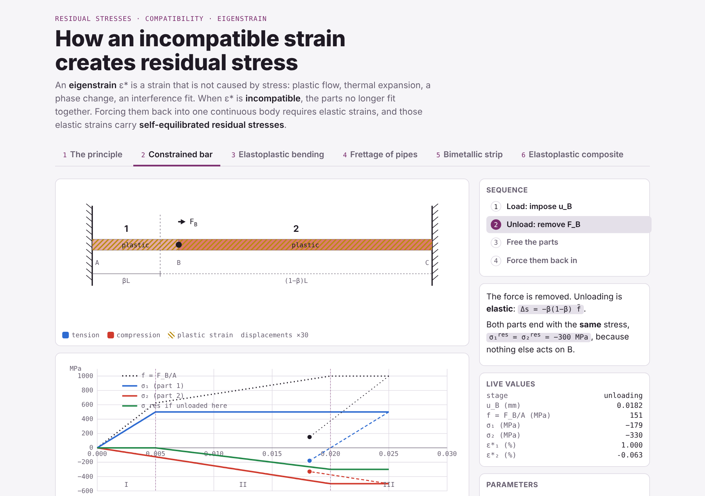

# Eigenstrain & Residual Stress Simulator

Interactive animations showing how an **incompatible strain** (eigenstrain) generates **self-equilibrated residual stresses**, through six elementary problems of solid mechanics.

The whole application is a single HTML file: no installation, no build step, no dependencies. Open it in a browser, or publish it with GitHub Pages.



**Live demo:** `https://<your-username>.github.io/residual-stress-animations/`
(available once GitHub Pages is enabled, see [Publishing](#publishing-with-github-pages)).

---

## The idea

An eigenstrain ε\* is a strain that is not caused by stress: plastic flow, thermal expansion, a phase change, an interference fit.

1. **Free** the parts that carry ε\*: each one takes its stress-free shape.
2. If ε\* is **incompatible**, the parts no longer fit together.
3. **Reassembling** them into one continuous body requires elastic strains.
4. Those elastic strains carry **residual stresses**, balanced without any external load.

Every animation follows this sequence: cut, free, reassemble, equilibrate.

## The six cases

| # | Case | What is animated | Model |
|---|------|------------------|-------|
| 1 | **The principle** | Surface-treated part: imaginary cut, free strain of the layer, sticking back, self-equilibrium, σ(z) profile | Bonded layer on a thick core, no bending |
| 2 | **Constrained elastoplastic bar** | Bar clamped at both ends, displacement imposed at an intermediate point: stages I, II, III, elastic unloading, eigenstrain view | After Korsunsky (2017) |
| 3 | **Elastoplastic bending** | Loading beyond Mₑ, elastic unloading, freed fibres, plane sections restored, residual curvature | Rectangular section, elastic–perfectly plastic |
| 4 | **Frettage of pipes** | Interference δ, heating of the outer tube, insertion, cooling, contact pressure, σθ and σr through the wall | Lamé thick cylinders, plane stress |
| 5 | **Bimetallic strip** | Free thermal mismatch, layers forced flat (N = 0, M ≠ 0), release and bending | Two-layer beam (Timoshenko) |
| 6 | **Elastoplastic composite** | Iso-strain loading, unloading with reverse yielding of the matrix, debonding and rebonding of the phases | Elastic fibres, elastic–perfectly plastic matrix |

Each tab offers:

- **Play / Pause**, a **timeline** you can scrub, and **clickable steps**;
- **parameter sliders** (β and ũ_B, M̃/Mₑ, δ, ΔT, f and ε̃…);
- a caption that updates with the formulas and current values;
- live **plots** (stresses vs displacement, M–κ, σ(r), σ–ε…).

Displacements and strains are exaggerated on screen; the scale factor is shown under each animation.

### Direct links to a tab

Add an anchor to the address:

| Anchor | Tab |
|--------|-----|
| `#principle` | The principle |
| `#bar` | Constrained elastoplastic bar |
| `#bending` | Elastoplastic bending |
| `#frettage` | Frettage of pipes |
| `#bimetal` | Bimetallic strip |
| `#composite` | Elastoplastic composite |

Example: `index.html#frettage`.


## Repository structure

```
residual-stress-animations/
├── index.html                       # the application (HTML + CSS + JS, single file)
├── assets/
│   └── preview.png                  # screenshot for this README
├── notes/
│   ├── compatibility_proof.tex/.pdf      # Saint-Venant compatibility: statement and proof
│   └── compatibility_derivation.tex/.pdf # from the strain equation to the compatibility equation
├── .nojekyll
├── .gitignore
├── CITATION.cff
├── LICENSE
└── README.md
```

### Course notes (`notes/`)

- **`compatibility_proof`**: statement and proof of the compatibility equations, ε_ij,kk + ε_kk,ij − ε_jk,ik − ε_ik,jk = 0, i.e. Inc(ε) = rot rot(ε) = 0. Necessity, equivalence with the full Saint-Venant system, and sufficiency on a simply connected domain.
- **`compatibility_derivation`**: how to obtain the compatibility equation from ε_ij = ½(u_i,j + u_j,i), in 2D, then in 3D, and through the rotation tensor.

To recompile: `pdflatex compatibility_proof.tex`.

## Models and assumptions

- Small strains, quasi-static loading, isotropic materials.
- Plasticity: elastic–perfectly plastic behaviour, no hardening.
- Unloading is computed analytically: elastic for cases 2 and 3, with possible reverse yielding of the matrix for case 6.
- Numerical values are typical, chosen for teaching (steel, copper, aluminium, SiC fibres); they are listed under each tab.

## References

- A. M. Korsunsky, *A Teaching Essay on Residual Stresses and Eigenstrains*, Butterworth-Heinemann (Elsevier), 2017.
- T. Mura, *Micromechanics of Defects in Solids*, Martinus Nijhoff, 2nd ed., 1987.
- S. Timoshenko, "Analysis of bi-metal thermostats", *Journal of the Optical Society of America*, 11(3), 233–255, 1925.
- S. Timoshenko, J. N. Goodier, *Theory of Elasticity*, McGraw-Hill, 3rd ed., 1970 (thick cylinders, compatibility).

## Author

**Dr Régis Kubler**, Arts et Métiers Institute of Technology.
Developed with the assistance of Claude Opus 5.5 (Anthropic), October 2026.

## Cite as

> Kubler, R. (2026). *Eigenstrain & Residual Stress Simulator*. Arts et Métiers Institute of Technology. Zenodo. DOI: https://doi.org/10.5281/zenodo.23322112

```bibtex
@software{kubler_2026_eigenstrain,
  author    = {Kubler, Régis},
  title     = {Eigenstrain \& Residual Stress Simulator},
  year      = {2026},
  month     = oct,
  publisher = {Zenodo},
  institution = {Arts et Métiers Institute of Technology},
  doi       = {https://doi.org/10.5281/zenodo.23322112}
}
```

GitHub also offers a **"Cite this repository"** button, generated from `CITATION.cff`.

## License

Distributed under the [MIT License](LICENSE). You may use, modify and redistribute this material freely, including for teaching, provided the copyright notice is kept.
